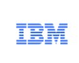
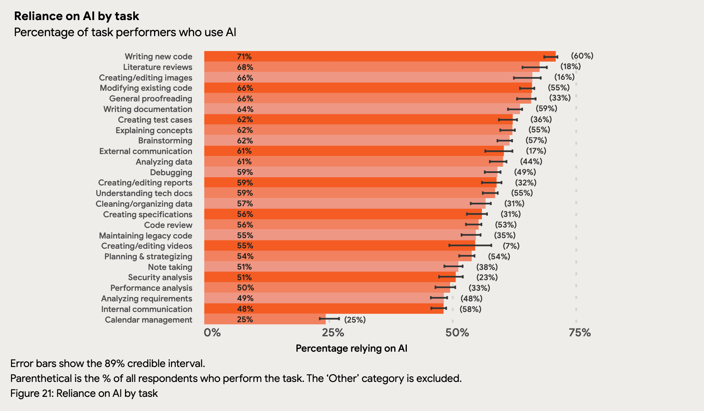
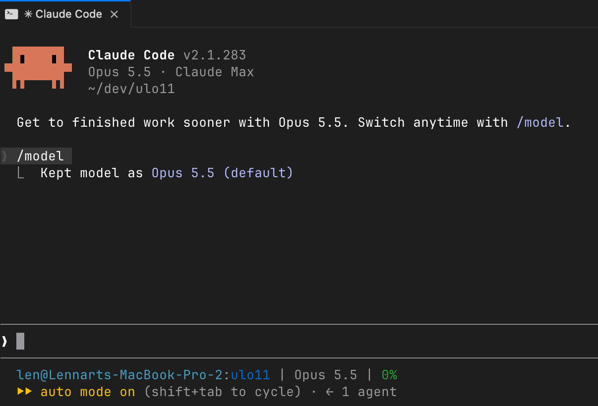

---

{.full}

::: notes
Watch together, then discuss with the group before the introduction.
:::

## Greetings from Venlo {#venlo}

**Lennart Tange**

Software Factory Engineering

::: notes
Excited to be here, I'm
:::

## Tell me something about you

https://form.menti.com/s/alftywx2b1ai

## My Career {#career}

::: timeline
- **1988**  Born in NL, 38 years ago
- **1998** My first code (BASIC)
- **2008** BSc Electrical Engineering
- **2011**  MSc Software Engineering *(cum laude)*
- **2011–2014**  R&D Software Engineer, full-stack (start-up, Ruby, model-based testing)
- **2014–2021**  R&D Lead Quality Architect (Watson/Cognos)
- **2021–2024**  Strategic Software Delivery Consultant
- **2024–**  Lecturer, coach, researcher
  - In Software Factory Engineering at **Fontys Venlo**
:::

::: more
More: [linkedin.com/in/lennarttange](https://www.linkedin.com/in/lennarttange/)
:::

::: notes
obsessed with: quality, learning things while having fun -->
leading teams towards continuous delivery
:::

## Software Engineers using AI (sept 2025)

 https://services.google.com/fh/files/misc/2025_state_of_ai_assisted_software_development.pdf")

## AI in software development

::: timeline
- **2021** GitHub Copilot
  - _A better auto-complete_
- **2025** Agentic coding tools
  - e.g. Claude Code
  - _"Vibe coding"_
- **2026** Autonomous agents, loops
- **2027+** ??? (not the topic of today)
:::

_"How do we keep up with the speed, without ==sacrificing quality==?"_

::: notes
- I want to share a few things about my workflow. There is no single right one.
- In many ways, not that much changed opposed to CD: get the right quality gates,learn to trust the process.
- Best thing to do, is keep yourself updated, experiment, stay critical.
:::

## AI is an amplifier {#amplifier}

 https://services.google.com/fh/files/misc/dora-roi-of-ai-assisted-software-development-2026.pdf")
")

::: notes
- fail/succeed faster
- pipeline adaption, learn to trust the process
:::

## Development with AI {#vibe-coding}

*The Good FAAFO* (Vibe Coding, Gene Kim & Steve Yegge, 2025):

- **F**aster
- **A**mbitious
- **A**utonomously
- **F**un
- **O**ptions

. . .

Great for feedback, quick experiments and personal projects.

<!-- fx: Bit to operating a slider that animates from "vibe coding" to "stay in control" -->

::: notes
Encourage students to try it out, its fun.
In the past months:
e.g. I learned about the stock market by making the app I wanted.

But also, I vibe-coded this powerpoint alternative last week (on top of reveal.js)
(the content is still my own!).

I've also a more serious project that is running for a year, with different collaborators - I do not feel in control anymore.

The hard thing is to stay in control. Its very tempting to just press enter.
:::

. . .

Not (often) a great way to **professionally** deliver software to customers.

**Accountability -> you**

## Getting started - tooling {#tooling}

The right tooling:
- Don't: use a webchat (e.g. ChatGPT)
- Instead: Use an IDE or CLI, e.g. Claude Code, OpenCode, ...

## Getting started - alignment {#plan}

Ensure alignment:

- Don't: "`Make a powerpoint alternative. make no mistakes`"
- Instead: "`/plan …`", "`/grill-me …`"

Use ==skills== for the AI to ask questions before implementing.

## Getting started - context {#context}

Between phases/features:

- Don't: keep working in the same session (context rot)
- Instead: clear sessions, even parallelize

Avoid the model getting 'dumber' over time, make sure you are often in a state where you can close the session and start over.

Tip: use `AGENTS.md` and other `.md` files to document glossary and decisions records.

## Getting started - small steps {#small}

- Don't: build a big thing (complete app, complicated feature) in one session
- Instead: break into smaller user stories ("story slicing"). Prefer vertical slices

Get to something you can validate as early as possible, in parts you can manage. Minimize the risk of your model hallicinating on features and your intentions.

::: notes
- example, I tried to create a video game (4x), based on a only vague idea. crap in -> crap out.
- story slicing: elephant carpaccio
:::

## Getting started - parallize {#parallel}

- Tip: If you want to stay in control, not always a good idea to multi-task.

Avoid different agents getting confused over each others changes by using a `git worktree`.

## Getting started - skills for your workflows {#custom-skills}

- Tip: use **custom skills** or make your own -  `/deck-spice only the last slide`.

Custom skills is a `.md` file with instructions -> give the agents a sequence of steps, including pointing to scripts to run, etc.

## Finally {#final}

- Critize AI and AI output
  - Stay in control, ==you== are ==accountable== for your work

. . .

- If you want to ==learn== something: ==turn off AI generation==

. . .

- Contribute to ==make the world a better place== for everyone
    AI might not do that for us

# Questions? {#questions}

::: countdown
:::
